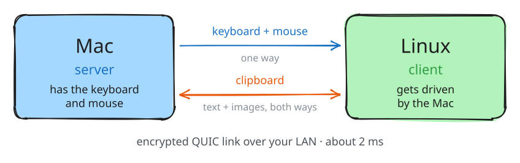
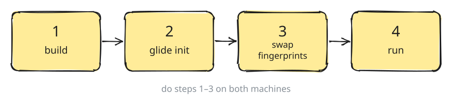
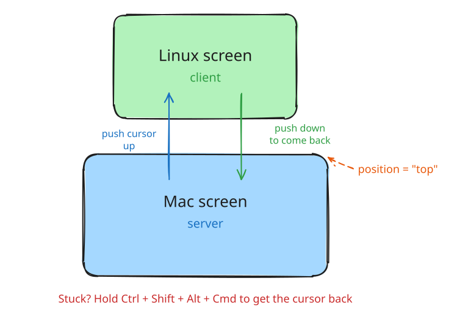
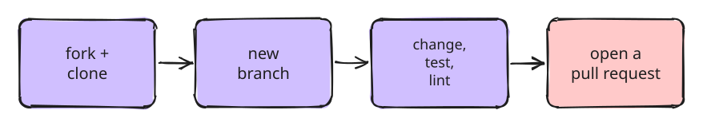

#  glide

**[Download](#download) · [Install](#install) · [Screens](#arranging-screens) · [Contributing](#contributing)**

[](https://github.com/code-zenx/glide/releases/latest)


One keyboard and mouse for your Mac and Linux box. Move the cursor off your Mac
screen and it shows up on Linux. Copy on one, paste on the other.

Inspired by [Barrier](https://github.com/debauchee/barrier) and
[lan-mouse](https://github.com/feschber/lan-mouse): Barrier does not work on
Wayland, and lan-mouse has no clipboard sync, so glide does both.



## What it does

- **Keyboard and mouse** go one way: from the Mac (server) to Linux (client).
- **Clipboard** goes both ways: text and images.
- **Fast**: about 2 ms on a wired network.
- **Safe**: the link is encrypted, and only your two machines can connect.
- Works with **macOS** and **Linux with Hyprland** (Wayland).

## Requirements

- A Mac with macOS 13 or newer (Apple Silicon for the download)
- A Linux PC running Hyprland (Wayland), with `wl-clipboard` installed for images
- Both on the same network

## Download

Get the latest build from [Releases](https://github.com/code-zenx/glide/releases/latest):

- **Mac:** `Glide-macos-arm64.zip`. Unzip it, move `Glide.app` to Applications, then run
  `xattr -dr com.apple.quarantine /Applications/Glide.app` once so macOS lets it open.
- **Linux:** `glide-linux-x86_64.tar.gz`. Unpack it into `~/.local/bin`.

Then follow steps 2 to 4 below. To build it yourself instead, you need
[Rust](https://rustup.rs).

## Install



### 1. Build

```sh
git clone https://github.com/code-zenx/glide.git
cd glide
```

On **macOS**, build the app:

```sh
bash contrib/bundle.sh        # installs /Applications/Glide.app
```

On **Linux**:

```sh
cargo build --release
install -Dm755 target/release/glide ~/.local/bin/glide
```

### 2. Create the server's config

Run this on the Mac, from the `glide` folder (or use
`/Applications/Glide.app/Contents/MacOS/glide` if you downloaded glide):

```sh
./target/release/glide init --name mymac --role server
```

### 3. Pair each Linux machine

Open Glide on the Mac, click **Add Device…** in its menu, and paste the copied
command into a terminal on the Linux machine:

```sh
glide join glide1+mymac+192.168.1.20:4242+<fingerprint>+<secret>
```

That creates the Linux machine's config and certificate, and the Mac adds it
on a free screen edge. No restart is needed. An invite works once and expires after ten
minutes. `glide invite` on the Mac prints the same command, for when you are
working over ssh. Pair as many machines as you like.

The Mac's menu lists every device. Each device's submenu turns it **On** or
**Off**: Off closes the connection, so nothing reaches it. The submenu also
makes the device the **extended display** (Hyprland only), or **forgets** it.
From a terminal, use `glide ctl peer on|off|forget <name>` and
`glide ctl extend <name>|off`.

<details><summary>Pairing by hand instead</summary>

Run `glide init --name mybox --role client` on Linux. Then add each machine
to the other's `~/.config/glide/config.toml`, using `glide fingerprint` from
each:

```toml
[[peer]]
name = "mybox"
addrs = ["192.168.1.50:4242"]
position = "top"                        # the client's side lists the opposite
fingerprint = "<fingerprint from the other machine>"
```

</details>

### 4. Run

**Mac:** open Glide from Applications. It does not start at login, so it only
runs when you open it. The first time, allow it in
System Settings → Privacy & Security:

- Input Monitoring
- Accessibility (called "Device Control and Data Access" on macOS 27)
- Local Network

**Linux:** start it with your session. Copy the service file:

```sh
cp contrib/glide.service ~/.config/systemd/user/
systemctl --user daemon-reload
```

Add these two lines to `hyprland.conf`:

```
exec-once = systemctl --user import-environment WAYLAND_DISPLAY XDG_RUNTIME_DIR HYPRLAND_INSTANCE_SIGNATURE
exec-once = systemctl --user start glide.service
```

On Xfce or another X11 desktop, add an autostart entry whose command is
`sh -c "systemctl --user import-environment DISPLAY XAUTHORITY && systemctl --user restart glide.service"`.
Building for X11 needs `libxtst-dev` (and GStreamer's dev packages, as on Wayland). To show the
glide badge in Xfce's top bar, follow the steps at the top of `contrib/glide-genmon.sh`.

That's it. Push the cursor off the edge and it moves to the other machine.

No mouse needed: on a Mac server, press and let go of Ctrl+Option+Cmd to send the keyboard and
mouse across while the cursor stays put. Press the same keys to bring them back. If the other
machine stops answering, Ctrl+Shift+Option+Cmd takes them back at once.

## Arranging screens



`position` says which edge of your screen the other machine is on:
`left`, `right`, `top` or `bottom`. The two machines must use opposite sides.

If you have more than one display, add `display = 1` (or 2, 3…) to pick which
display owns the edge.

On the Mac you can also drag the screens into place: open the menu bar icon and
choose **Arrange Screens…**. The other machine is updated for you.

**Cursor stuck?** Hold `Ctrl + Shift + Alt + Cmd` together to get it back.

## Check what it is doing

On Linux:

```sh
glide status            # ● 1.8ms  or  → mymac  or  ✕ offline
glide status --json     # for waybar
```

On the Mac, the menu bar icon shows the same thing. For a waybar module, see
[contrib/waybar-glide.md](contrib/waybar-glide.md).

## Tips

- **macOS keeps asking for permissions after every rebuild?** macOS forgets
  permissions when the app's signature changes. Sign it with a certificate,
  even a self-signed one, and `contrib/bundle.sh` will use it. See the notes at
  the top of that file.
- **Images do not paste on Linux?** Another program reading the clipboard can
  cancel it. Check for stray `wl-paste --watch` processes.
- **Don't run lan-mouse at the same time.** It uses the same port and screen edges.

## Limits

- Two machines only: one Mac and one Linux PC.
- The cursor does not land at the same spot on the other screen.
- Cmd and Super keys are not swapped.
- You type the other machine's IP by hand.

## Contributing



1. Fork the repo on GitHub and clone your fork.
2. Make a branch: `git checkout -b my-change`
3. Make your change, then check it:

   ```sh
   cargo build
   cargo test
   cargo clippy --all-targets
   ```

4. Commit with a short, simple message, for example `Fix cursor stuck at screen edge`.
5. Push and open a pull request. Say what you changed and why.

Good first things to work on:

- Land the cursor at the same spot on the other screen
- Swap Cmd and Super keys between macOS and Linux
- Find the other machine on the network without typing its IP

The diagrams are in `docs/images`. Open a `.excalidraw` file at
[excalidraw.com](https://excalidraw.com), edit it, and export it as SVG with the
same name.

## Credits

- [Barrier](https://github.com/debauchee/barrier) for the idea of a server and a client.
- [lan-mouse](https://github.com/feschber/lan-mouse) for the input capture and
  emulation code glide is built on.

## License

GPL-3.0, the same as the lan-mouse code it uses.
